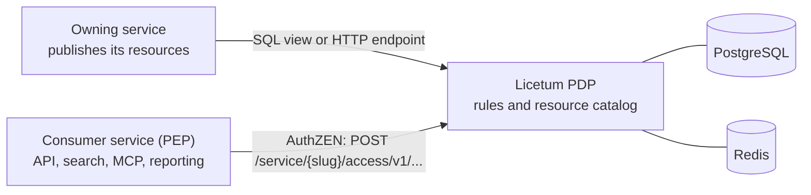

# Licetum

[](https://github.com/Licetum/licetum/actions/workflows/ci.yml)


## Languages

**English** · [Русский](docs/README.ru.md) · [简体中文](docs/README.zh-CN.md)

**Connect your services once. Ask once. Explain every answer.**

Licetum is a central authorization service for microservice teams. Each service publishes its resources
once. Any consumer then asks one question, *what can this user access?*, and gets an answer it can apply to
its own API, UI or database query. Every answer can be explained. The name comes from the Latin *licet*,
"it is permitted".

## Why Licetum

In a microservice architecture, permissions are spread across databases, config files and home-grown
services. Every service that needs to know "which projects can this user see?" ends up with its own
endpoint, its own export format and its own reading of the rules. The copies drift apart: one service shows
a project that another one hides.

Licetum replaces the copies with one contract:

- The owning service keeps its data and decides which of its resources are published.
- Licetum holds the rules: who may do what on which resources, with which denials and exceptions, and for
  how long.
- Consumers ask one question and apply the answer: a list of allowed IDs, or a yes/no decision.

Licetum does not store business records, does not replace your identity provider, and does not enforce
access on your behalf. Services that receive an answer remain responsible for applying it.

## How it works



The PDP speaks the [OpenID AuthZEN Authorization API 1.0](https://openid.net/specs/authorization-api-1_0.html),
scoped to a service: the path names the service by its slug. A consumer is a policy enforcement point (PEP). An
administrator registers it as a *PEP client* of the service, and it authenticates with an API key that Licetum issues or
with an access token of an identity provider the administrator registered. The PEP names the person it asks about and
vouches for their claims, as the `subject` of the question:

```http
POST /service/orders/access/v1/evaluation
Authorization: Bearer <api-key>
Content-Type: application/json

{
  "subject": { "type": "user", "id": "alice", "properties": { "department": "sales" } },
  "resource": { "type": "project", "id": "2" },
  "action": { "name": "write" },
  "context": { "licetum": { "explain": true } }
}
```

The answer is the decision. With `explain` (a PEP client needs the operation for it), it says which rules grant the
level, which denials apply, and which exceptions lift them:

```json
{ "decision": true, "context": { "reason_admin": { "decision": "allowed", "granted_by": [ ... ] } } }
```

To list instead of ask, the resource search returns the resources of a type that the person may use for an action. A
consumer can put the IDs in a `WHERE` filter or in a row-level security policy:

```http
POST /service/orders/access/v1/search/resource
Authorization: Bearer <api-key>
Content-Type: application/json

{
  "subject": { "type": "user", "id": "alice", "properties": { "department": "sales" } },
  "resource": { "type": "project" },
  "action": { "name": "read" },
  "page": { "limit": 100 }
}
```

```json
{ "results": [ { "type": "project", "id": "1", "properties": { "name": "Project 1" } }, ... ], "page": { "count": 2 } }
```

`POST …/access/v1/evaluations` decides a batch (with the `evaluations_semantic` option), and the action and subject
searches list the levels on a resource and the people who may use it.

## Features

- **One visibility contract.** Every consumer asks the same question and gets the same answer, whether it is
  an API, a search index, an MCP tool or a reporting job.
- **Exact resource IDs.** The answer lists the allowed resources by their IDs, so a consumer can use them in
  a `WHERE` filter or in a row-level security policy.
- **Explainable decisions.** Every answer can show the rules behind it: what grants access, what denies it,
  and what lifts the denial.
- **Allow, deny and exceptions.** A deny rule wins over an allow rule. An exception placed below a denial
  lifts it for the resources it covers.
- **Hierarchies across services.** A permission on a parent resource reaches the resources below it, even
  when the parent and the children belong to different services.
- **Groups and roles.** Groups say *who*: they can be nested, and membership can come from token claims such
  as `department`. Roles say *what*: named sets of access levels that are granted to a user, a group or
  everyone who matches some claims.
- **Attribute-based rules.** A rule can match resources by the attributes their source publishes, such as an
  `owner` field, and conditions can read token claims, request context or the time of day.
- **Time-bound access.** Start and expiry dates on rules and group memberships support temporary access.
- **Policy as code.** Lint a service's policy, run test scenarios against it, export it as a
  `licetum.policy/v1` document, and import it with a dry run first.
- **History you can revert.** Every change is recorded with the entity before and after. A recorded change
  can be reverted on its own, or several can be rolled back as one batch.

## Who it is for

- **Architecture and platform teams** get one contract for resource visibility across services.
- **Service developers** make one call instead of building a permissions endpoint for each consumer.
- **Access administrators** grant and revoke access in one place and can see why a person has it.
- **Security reviewers** get answers that can be explained and a change history that can be audited.

## Quick start

You need Docker and [Task](https://taskfile.dev).

```bash
task dev
```

This starts PostgreSQL, Redis, a local Dex OIDC provider, the PDP, the admin API and the web interface,
with hot reload for the Go services and the web interface.

| Component | URL |
|---|---|
| Web interface | http://localhost:3000 |
| Admin API | http://localhost:8002 |
| PDP | http://localhost:8001 |

Sign in at http://localhost:3000 as `admin@example.com` with the password `password`. These credentials are
for development only.

To run the Go binaries without Docker, see the guides for the [core](core/README.md) and the
[admin API](admin-api/README.md). Each can print its OpenAPI specification without a server:
`licetum openapi pdp` for the PDP, `licetum-admin openapi admin` for the admin API.

## What Licetum is not

- It is not an identity provider. The service that asks names the person and vouches for their claims; administrators
  sign in through your OIDC provider.
- It is not a business database. Source services keep their records and remain responsible for CRUD.
- It is not a database RLS extension. Licetum provides allowed IDs or decisions. Your service applies them to
  its own queries and storage.
- It is not only a frontend filter. Backend and data-access layers must enforce the result.

## Documentation

- [core/](core/README.md): the engine, the PDP, the database schema and migrations (MIT).
- [admin-api/](admin-api/README.md): the admin API, the policy tools and the `licetum-admin` binary (AGPL-3.0).
- [web/](web/README.md): the admin interface (AGPL-3.0).

## Repositories

The project lives in the [Licetum](https://github.com/Licetum) organization:

- [licetum](https://github.com/Licetum/licetum): this repository, with the engine, the APIs and the web interface.
- [licetum-go-sdk](https://github.com/Licetum/licetum-go-sdk), [licetum-ts-sdk](https://github.com/Licetum/licetum-ts-sdk),
  [licetum-python-sdk](https://github.com/Licetum/licetum-python-sdk): client libraries for the PDP (to be
  published; each will carry its own license file).
- [licetum-helm](https://github.com/Licetum/licetum-helm): the Helm chart.
- [licetum-docs](https://github.com/Licetum/licetum-docs): the documentation.

## Contributing

Read [CONTRIBUTING.md](CONTRIBUTING.md) before opening a pull request. To report a security vulnerability,
follow [SECURITY.md](SECURITY.md) and do not open a public issue.

## License

Licetum is made of three parts, each under its own license (see [LICENSE](LICENSE)):

- [`core/`](core/LICENSE): the engine, the PDP, the database schema and the runtime. MIT License.
- [`admin-api/`](admin-api/LICENSE): the admin API. GNU Affero General Public License v3.0 only.
- [`web/`](web/LICENSE): the admin interface. GNU Affero General Public License v3.0 only.

If you run a modified `admin-api/` or `web/` as a network service, the AGPL requires you to offer its source to
the users of that service. The names and logos of Licetum are not covered by these licenses
([TRADEMARKS.md](TRADEMARKS.md)).
