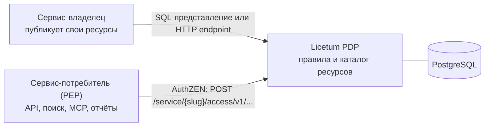

# Licetum

[](https://github.com/Licetum/licetum/actions/workflows/ci.yml)


## Языки

[English](../README.md) · **Русский** · [简体中文](README.zh-CN.md)

**Подключите сервисы один раз. Спрашивайте один раз. Каждый ответ можно объяснить.**

Licetum — центральный сервис авторизации для команд микросервисов. Каждый сервис публикует свои ресурсы
один раз. Затем любой потребитель задаёт один вопрос — *к каким сущностям есть доступ у этого пользователя?* —
и получает ответ, который может применить к своему API, интерфейсу или запросу к базе. Каждый ответ можно
объяснить. Название происходит от латинского *licet* — «дозволено».

## Зачем Licetum

В архитектуре микросервисов права рассыпаны по базам данных, конфигам и самописным сервисам. Каждому сервису,
которому нужно знать, «какие проекты может видеть этот пользователь», приходится строить собственный endpoint,
собственный формат экспорта и собственное понимание правил. Копии расходятся: один сервис показывает проект,
который другой скрывает.

Licetum заменяет копии одним контрактом:

- Сервис-владелец хранит свои данные и решает, какие из его ресурсов публикуются.
- Licetum хранит правила: кто что может делать с какими ресурсами, с какими запретами и исключениями и на какой срок.
- Потребители задают один вопрос и применяют ответ: список разрешённых ID или решение «да/нет».

Licetum не хранит бизнес-записи, не заменяет провайдер идентификации и не обеспечивает доступ вместо ваших
сервисов. Сервис, получивший ответ, по-прежнему отвечает за его применение.

## Как это работает



PDP говорит на [OpenID AuthZEN Authorization API 1.0](https://openid.net/specs/authorization-api-1_0.html) в границах одного
сервиса: путь называет сервис его slug. Потребитель — это точка применения политики (PEP). Администратор регистрирует его
как *PEP-клиент* сервиса, и он аутентифицируется API-ключом, который выдаёт Licetum, или токеном зарегистрированного
администратором провайдера идентификации. PEP называет человека, о котором спрашивает, и ручается за его claims, передавая
их как `subject` вопроса:

```http
POST /service/orders/access/v1/evaluation
Authorization: Bearer <api-key>
Content-Type: application/json

{
  "subject": { "type": "user", "id": "alice", "properties": { "department": "sales" } },
  "resource": { "type": "project", "id": "2" },
  "action": { "name": "write" },
  "context": { "licetum": { "explain": true } }
}
```

Ответ — решение. С `explain` (PEP-клиенту нужна для этого операция `explain`) он говорит, какие правила дают уровень
доступа, какие запреты действуют и какие исключения их снимают:

```json
{ "decision": true, "context": { "reason_admin": { "decision": "allowed", "granted_by": [ ... ] } } }
```

Чтобы получить список, а не решение, поиск ресурсов возвращает ресурсы типа, доступные человеку для действия.
Потребитель может использовать эти ID в фильтре `WHERE` или в политике построчной безопасности:

```http
POST /service/orders/access/v1/search/resource
Authorization: Bearer <api-key>
Content-Type: application/json

{
  "subject": { "type": "user", "id": "alice", "properties": { "department": "sales" } },
  "resource": { "type": "project" },
  "action": { "name": "read" },
  "page": { "limit": 100 }
}
```

```json
{ "results": [ { "type": "project", "id": "1", "properties": { "name": "Project 1" } }, ... ], "page": { "count": 2 } }
```

`POST …/access/v1/evaluations` решает пакет вопросов (с параметром `evaluations_semantic`), а поиск действий и субъектов
перечисляет уровни доступа к ресурсу и людей, которым он доступен.

## Возможности

- **Один контракт видимости.** Каждый потребитель задаёт один и тот же вопрос и получает один и тот же ответ,
  будь то API, поисковый индекс, MCP-инструмент или отчётный процесс.
- **Точные ID ресурсов.** Ответ перечисляет разрешённые ресурсы по их ID, поэтому потребитель может использовать
  их в фильтре `WHERE` или в политике безопасности на уровне строк (row-level security).
- **Объяснимые решения.** Каждый ответ может показать правила, за которыми он стоит: что даёт доступ, что его
  запрещает и что снимает запрет.
- **Разрешения, запреты и исключения.** Запрет важнее разрешения. Исключение, стоящее ниже запрета, снимает его
  для ресурсов, которые оно покрывает.
- **Иерархии между сервисами.** Право на родительский ресурс распространяется на нижележащие ресурсы, даже если
  родитель и дочерние ресурсы принадлежат разным сервисам.
- **Группы и роли.** Группы отвечают на вопрос «кто»: их можно вкладывать друг в друга, а членство может
  определяться claims токена, например `department`. Роли отвечают на вопрос «что»: именованные наборы уровней
  доступа, которые выдаются пользователю, группе или всем, кто подходит под claims.
- **Правила на основе атрибутов.** Правило может сопоставлять ресурсы по атрибутам, которые публикует их источник,
  например по полю `owner`. Условия могут читать claims токена, контекст запроса или время суток.
- **Доступ с ограниченным сроком.** Даты начала и окончания для правил и членства в группах поддерживают
  временный доступ.
- **Политика как код.** Политику сервиса можно проверить линтером, прогнать против неё тестовые сценарии,
  экспортировать в документ `licetum.policy/v1` и импортировать с предварительным прогоном без записи (dry run).
- **История с откатом.** Каждое изменение записывается вместе с состоянием сущности до и после него. Изменение
  можно откатить отдельно, а несколько изменений — одним пакетным откатом.

## Кому это нужно

- **Команды архитектуры и платформы** получают один контракт видимости ресурсов между сервисами.
- **Разработчики сервисов** делают один вызов вместо собственного endpoint прав для каждого потребителя.
- **Администраторы доступа** выдают и отзывают доступ в одном месте и видят, почему у человека есть доступ.
- **Специалисты по безопасности** получают ответы, которые можно объяснить, и историю изменений, которую можно проверить.

## Быстрый старт

Нужны Docker и [Task](https://taskfile.dev).

```bash
task dev
```

Команда поднимает PostgreSQL, локальный провайдер Dex OIDC, PDP, воркер синхронизации, административный API и
веб-интерфейс с горячей перезагрузкой для Go-сервисов и веб-интерфейса.

| Компонент | Адрес |
|---|---|
| Веб-интерфейс | http://localhost:3000 |
| Административный API | http://localhost:8002 |
| PDP | http://localhost:8001 |

Войдите на http://localhost:3000 как `admin@example.com` с паролем `password`. Эти данные предназначены
только для разработки.

Чтобы запускать Go-бинарники без Docker, см. руководства для [core](../core/README.md) и
[admin API](../admin-api/README.md). Каждый из них может вывести свою спецификацию OpenAPI без сервера:
`licetum openapi pdp` — для PDP, `licetum-admin openapi admin` — для административного API.

## Чем Licetum не является

- Это не провайдер идентификации. Спрашивающий сервис называет человека и ручается за его claims; администраторы
  входят через ваш провайдер OIDC.
- Это не бизнес-база данных. Исходные сервисы хранят свои записи и отвечают за CRUD.
- Это не расширение RLS базы данных. Licetum возвращает разрешённые ID или решения, а потребляющий сервис
  применяет их к своим запросам и слою хранения.
- Это не только фильтр на фронтенде. Бэкенд и слой доступа к данным должны принудительно применять результат.

## Документация

- [core/](../core/README.md): движок, PDP, схема базы данных и миграции (MIT).
- [admin-api/](../admin-api/README.md): административный API, инструменты политики и бинарник `licetum-admin`
  (AGPL-3.0).
- [web/](../web/README.md): административный интерфейс (AGPL-3.0).

## Репозитории

Проект находится в организации [Licetum](https://github.com/Licetum):

- [licetum](https://github.com/Licetum/licetum): этот репозиторий, с движком, API и веб-интерфейсом.
- [licetum-go-sdk](https://github.com/Licetum/licetum-go-sdk), [licetum-ts-sdk](https://github.com/Licetum/licetum-ts-sdk),
  [licetum-python-sdk](https://github.com/Licetum/licetum-python-sdk): клиентские библиотеки для PDP
  (будут опубликованы; у каждой будет свой файл лицензии).
- [licetum-helm](https://github.com/Licetum/licetum-helm): Helm-чарт.
- [licetum-docs](https://github.com/Licetum/licetum-docs): документация.

## Участие в разработке

Перед открытием pull request прочитайте [CONTRIBUTING.md](../CONTRIBUTING.md). Чтобы сообщить об уязвимости,
следуйте [SECURITY.md](../SECURITY.md) и не открывайте публичный issue.

## Лицензия

Licetum состоит из трёх частей, у каждой своя лицензия (см. [LICENSE](../LICENSE)):

- [`core/`](../core/LICENSE): движок, PDP, схема базы данных и среда выполнения. Лицензия MIT.
- [`admin-api/`](../admin-api/LICENSE): административный API. GNU Affero General Public License v3.0 only.
- [`web/`](../web/LICENSE): административный интерфейс. GNU Affero General Public License v3.0 only.

Если вы запускаете изменённые `admin-api/` или `web/` как сетевой сервис, AGPL требует предоставить исходный код
пользователям этого сервиса. Названия и логотипы Licetum этими лицензиями не покрываются
([TRADEMARKS.md](../TRADEMARKS.md)).
