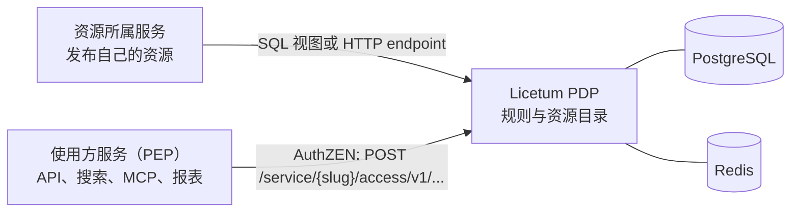

# Licetum

[](https://github.com/Licetum/licetum/actions/workflows/ci.yml)


## 语言

[English](../README.md) · [Русский](README.ru.md) · **简体中文**

**连接一次服务。提问一次。每个答案都能解释。**

Licetum 是面向微服务团队的中央授权服务。每个服务只需发布一次自己的资源。随后，任何使用方都可以提出一个问题——*这个用户能访问哪些实体？*——并获得一个可以直接应用于自身 API、界面或数据库查询的答案。每个答案都可以解释。名称来自拉丁语 *licet*，意为“允许”。

## 为什么需要 Licetum

在微服务架构中，权限分散在各个数据库、配置文件和自研服务里。每个需要回答“这个用户能看到哪些项目？”的服务，最终都要实现自己的 endpoint、自己的导出格式，以及自己对规则的理解。这些副本会逐渐产生差异：一个服务展示的项目，另一个服务却会隐藏。

Licetum 用一份统一的契约取代这些副本：

- 资源所属服务保留自己的数据，并决定发布哪些资源。
- Licetum 保存规则：谁可以对哪些资源执行什么操作、有哪些拒绝和例外，以及持续多长时间。
- 使用方只提出一个问题，并应用答案：得到允许的 ID 列表，或是“是/否”的决策。

Licetum 不保存业务记录，不替代身份提供方，也不代替您的服务执行访问控制。收到答案的服务仍然负责应用这个答案。

## 工作方式



PDP 使用 [OpenID AuthZEN Authorization API 1.0](https://openid.net/specs/authorization-api-1_0.html)，并限定在单个服务内：路径
以 slug 指明服务。使用方是策略执行点（PEP）。管理员把它注册为服务的 *PEP 客户端*，它用 Licetum 签发的 API 密钥，或用管理员
注册的身份提供方签发的访问令牌进行认证。PEP 指明要询问的人，并以问题中的 `subject` 为其 claims 担保：

```http
POST /service/orders/access/v1/evaluation
Authorization: Bearer <api-key>
Content-Type: application/json

{
  "subject": { "type": "user", "id": "alice", "properties": { "department": "sales" } },
  "resource": { "type": "project", "id": "2" },
  "action": { "name": "write" },
  "context": { "licetum": { "explain": true } }
}
```

响应就是决策。设置 `explain` 后（PEP 客户端需要 `explain` 操作），它会说明哪些规则授予了访问级别、哪些拒绝生效，以及哪些例外取消了这些拒绝：

```json
{ "decision": true, "context": { "reason_admin": { "decision": "allowed", "granted_by": [ ... ] } } }
```

如果需要列表而不是单个决策，资源搜索会返回此人可对某操作使用的该类型资源。使用方可以把这些 ID 用在 `WHERE` 过滤或行级安全策略中：

```http
POST /service/orders/access/v1/search/resource
Authorization: Bearer <api-key>
Content-Type: application/json

{
  "subject": { "type": "user", "id": "alice", "properties": { "department": "sales" } },
  "resource": { "type": "project" },
  "action": { "name": "read" },
  "page": { "limit": 100 }
}
```

```json
{ "results": [ { "type": "project", "id": "1", "properties": { "name": "Project 1" } }, ... ], "page": { "count": 2 } }
```

`POST …/access/v1/evaluations` 批量决策（带 `evaluations_semantic` 选项），操作搜索和主体搜索则分别列出资源上的访问级别和可使用它的人员。

## 功能

- **统一的可见性契约。** 每个使用方都提出同样的问题，并得到同样的答案，无论是 API、搜索索引、MCP 工具还是报表任务。
- **精确的资源 ID。** 响应以 ID 列出允许访问的资源，使用方可以把这些 ID 用于 `WHERE` 过滤条件，或行级安全（row-level security）策略。
- **可解释的决策。** 每个答案都可以展示其依据：什么授予了访问，什么拒绝了访问，什么取消了拒绝。
- **允许、拒绝与例外。** 拒绝规则优先于允许规则。位于拒绝规则之下的例外，会对其覆盖的资源取消该拒绝。
- **跨服务层级。** 对父资源的权限会延伸到其下的资源，即使父资源和子资源属于不同服务。
- **用户组与角色。** 用户组回答“谁”：可以相互嵌套，成员关系还可以依据令牌中的 claims（例如 `department`）判定。角色回答“能做什么”：一组命名的访问级别，可以授予用户、用户组，或授予所有符合 claims 的人。
- **基于属性的规则。** 规则可以按资源来源发布的属性匹配资源，例如 `owner` 字段。条件可以读取令牌 claims、请求上下文或当天的时间。
- **有时限的访问。** 规则和用户组成员关系都可以设置生效和过期时间，支持临时访问。
- **策略即代码。** 可以用 linter 检查服务策略，对其运行测试场景，将其导出为 `licetum.policy/v1` 文档，并先以 dry run 方式预览导入结果。
- **可回滚的历史。** 每次变更都会记录实体变更前后的状态。单个已记录的变更可以单独回滚，多个变更也可以作为一个批次回滚。

## 适用对象

- **架构与平台团队**：获得跨服务的统一资源可见性契约。
- **服务开发者**：只需一次调用，无需为每个使用方构建权限 endpoint。
- **访问管理员**：可以在一处授予和撤销访问，并能看到某人拥有访问权限的原因。
- **安全审核人员**：获得可以解释的答案，以及可以审计的变更历史。

## 快速开始

需要安装 Docker 和 [Task](https://taskfile.dev)。

```bash
task dev
```

该命令会启动 PostgreSQL、Redis、本地 Dex OIDC 提供方、PDP、管理 API 和 Web 界面。Go 服务和 Web 界面都支持热重载。

| 组件 | 地址 |
|---|---|
| Web 界面 | http://localhost:3000 |
| 管理 API | http://localhost:8002 |
| PDP | http://localhost:8001 |

请在 http://localhost:3000 使用 `admin@example.com` 和密码 `password` 登录。这些凭据仅用于开发。

如果要在不使用 Docker 的情况下运行 Go 二进制文件，请参阅 [core](../core/README.md) 和 [admin API](../admin-api/README.md) 指南。两者都可以在不启动服务的情况下输出 OpenAPI 规范：`licetum openapi pdp` 输出 PDP 的规范，`licetum-admin openapi admin` 输出管理 API 的规范。

## Licetum 不是什么

- 它不是身份提供方。发起询问的服务指明具体的人并为其 claims 担保；管理员通过您的 OIDC 提供方登录。
- 它不是业务数据库。源服务保存自己的记录，并负责 CRUD。
- 它不是数据库 RLS 扩展。Licetum 返回允许的 ID 或决策，由使用方将其应用到自己的查询和存储层。
- 它不只是前端过滤器。后端和数据访问层必须强制执行结果。

## 文档

- [core/](../core/README.md)：引擎、PDP、数据库结构与迁移（MIT）。
- [admin-api/](../admin-api/README.md)：管理 API、策略工具和 `licetum-admin` 二进制文件（AGPL-3.0）。
- [web/](../web/README.md)：管理界面（AGPL-3.0）。

## 仓库

项目位于 [Licetum](https://github.com/Licetum) 组织：

- [licetum](https://github.com/Licetum/licetum)：本仓库，包含引擎、API 和 Web 界面。
- [licetum-go-sdk](https://github.com/Licetum/licetum-go-sdk)、[licetum-ts-sdk](https://github.com/Licetum/licetum-ts-sdk)、
  [licetum-python-sdk](https://github.com/Licetum/licetum-python-sdk)：PDP 的客户端库（尚待发布；每个库都会附带自己的许可证文件）。
- [licetum-helm](https://github.com/Licetum/licetum-helm)：Helm chart。
- [licetum-docs](https://github.com/Licetum/licetum-docs)：文档。

## 参与贡献

提交 pull request 前，请先阅读 [CONTRIBUTING.md](../CONTRIBUTING.md)。如需报告安全漏洞，请遵循 [SECURITY.md](../SECURITY.md)，不要公开提交 issue。

## 许可证

Licetum 由三部分组成，每部分采用各自的许可证（见 [LICENSE](../LICENSE)）：

- [`core/`](../core/LICENSE)：引擎、PDP、数据库结构和运行时。MIT 许可证。
- [`admin-api/`](../admin-api/LICENSE)：管理 API。仅适用 GNU Affero General Public License v3.0。
- [`web/`](../web/LICENSE)：管理界面。仅适用 GNU Affero General Public License v3.0。

如果您将修改后的 `admin-api/` 或 `web/` 作为网络服务运行，AGPL 要求您向该服务的用户提供其源代码。Licetum 的名称和标志不受这些许可证覆盖（见 [TRADEMARKS.md](../TRADEMARKS.md)）。
